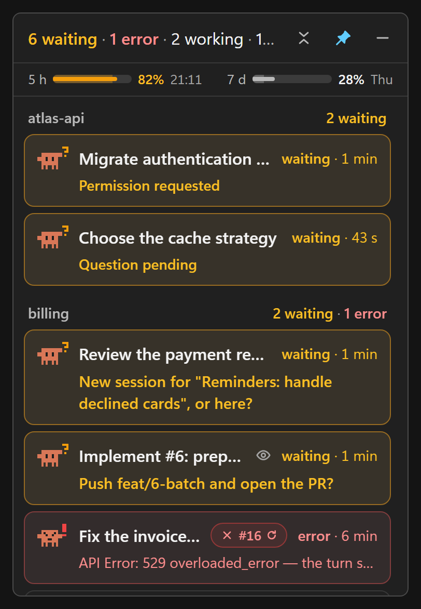

# Turnwatch

[](LICENSE)

A small always-on-top Windows window that shows, live, the state of the Claude Code sessions started from the Code tab of Claude Desktop. The idea: minimize Claude Desktop and keep on screen only what matters, which is the session waiting for you, or else a short summary.

<p align="center">
  
</p>

> **Unofficial.** This is an independent project, not affiliated with or endorsed by Anthropic. It reads undocumented files of Claude Desktop and Claude Code, so an update of either can break part of the display.

Sessions are grouped by project, and the projects that need you come first. Each card takes one or two lines:

- the session's character, whose pose tells its state and whose held item tells the current tool (see **States**), then the state and how long it has lasted ("waiting · 3 h", "working · 12 s", "unseen · 5 min"), with the PR if one is open, colored by its CI, and a small circular arrow when Desktop's Auto-fix watches it;
- a second line only when it is useful: the question asked if the session is waiting for you ("Plan to approve: …" for a plan), the error, what it is waiting for once its turn is over ("Waiting for a command: cargo test"), the progress of the task list (`3/7 · Write the tests`) while it works, or the outcome of a code review that just finished ("Review: 13 findings, 5 confirmed").

The rest is in the card's tooltip: branch, uncommitted files, summary of the last turn, last tool, parent session, messages between sessions.

Claude Desktop already notifies about finished turns, so the monitor only sends **reminders**: a session that has been waiting for you for more than 5 minutes with no answer. It stays quiet when the session is visible in a Desktop pane in the foreground, and for a mere "probable question". Several reminders due at the same time form a single notification ("3 sessions are still waiting for you").

It also warns when the plan's quota crosses a threshold: the 5-hour window at 80% then 95%, the week at 90%, with the time left before the reset ("5-hour quota at 82%", "Resets in 1 h 20"). Each threshold is announced once per window, and a threshold already passed when the monitor starts is not announced. These alerts rely on Claude Desktop sampling the quota, which it only does for a few hours after a right-click on its icon (see **Quota** below). A notification therefore tells you when it has stopped: a session is working, you are at the computer, and there has been no sample for 20 minutes ("Quota: sampling stopped"). A pause of more than 10 minutes without touching the keyboard or mouse restarts that count, because Desktop also skips its samples while the computer is idle or locked. It is sent once per stop, and the "Notify the quota" setting turns it off too. With the companion mod (see **Companion mod**), sessions report the quota themselves: this notification has no reason to exist and is not sent.

The window, the tray menu, the notifications and the installer are in English and French. They follow Windows' display language, and the tray menu lets you choose (see **Usage**).

## Requirements

- Windows 10 or 11, with the WebView2 runtime (already there on Windows 11).
- Claude Desktop with the Code tab. Tested with Claude Desktop 4.4212 and Claude Code 2.1.309.
- `git` on the PATH for branches and uncommitted files.
- `gh` logged in (`gh auth login`) for PR status. Without `gh`, everything else works.

To build: stable Rust (MSVC), the Visual Studio Build Tools, Node.js and pnpm.

## Install

Download `Turnwatch_<version>_x64-setup.exe` from the [Releases](https://github.com/alexiscrocilla/turnwatch/releases) page and run it. Each release also gives the installer's SHA-256 in `SHA256SUMS.txt`.

The installer asks for no administrator rights: everything goes in the current Windows account, the app in `%LOCALAPPDATA%\Turnwatch`. It adds a Start menu shortcut and an entry in "Installed apps", from which you can uninstall it.

It also adds to Claude Desktop what the exact quota and the sub-agents need: the companion mod, loaded by every session started after the installation (see **Companion mod**). Nothing needs restarting. If Claude Desktop has never opened its Code tab, the mod cannot be added: the installer says so and finishes anyway. Opening the tab once, then running the installer again, makes up for it.

The installer is not signed: Windows SmartScreen may show "Windows protected your PC" the first time. Choose "More info", then "Run anyway".

## Updates

Turnwatch updates itself from this repository's releases. 30 seconds after it starts, then every 6 hours, it reads the latest release's `latest.json`. When that version is newer, it downloads the installer, checks its signature, says so in a notification and hands over to the installer, which runs with no window and restarts the app. Nothing else changes: settings, sessions already seen, the window's position and whether it was hidden, "Start with Windows" and the mod stay as they were. Sessions keep running: only the monitor restarts.

The **Update automatically** item of the tray menu turns the checks off, and **Check for updates** runs one at once. Only the installed app updates itself: the executable from a build does not.

Version 0.1.0 predates all this: to leave it, run the new installer by hand once. To update by hand at any time, run the installer of the new version. It first goes through the uninstaller of the old one: leave "Delete the application data" unticked there. Settings, sessions already seen and "Start with Windows" are then kept.

## Build and run

```bash
git clone https://github.com/alexiscrocilla/turnwatch.git
```

```bash
pnpm install
```

```bash
pnpm tauri build
```

The installer is then in `src-tauri\target\release\bundle\nsis\`, and the executable is `src-tauri\target\release\turnwatch.exe`. The executable runs as is, with no installation, but without the mod or updates. `pnpm tauri build --no-bundle` produces only the executable.

For development, with live reload of the interface:

```bash
pnpm tauri dev
```

## Usage

- **Header**: the summary ("1 waiting · 4 working · 2 unseen"), then three buttons: compact mode, pin on top, hide. Dragging the header moves the window.
- **Quota**: under the header, one gauge per window of the plan, 5 hours and 7 days. The thin bar shows the share used (grey, amber from 75%, red from 90%), the zone tinted the same color behind it shows the share of the window's time elapsed: a bar that goes past its zone is using the plan faster than a steady pace. Next come the percentage and the reset time (or day), exact with the companion mod, estimated without it. The tooltip gives the details and the time of the sample. Without the mod, if Desktop has sampled nothing for more than 20 minutes, a line under the gauges says so and tells how to restart it ("No sample since 08:17: right-click Claude Desktop's icon to restart it"); a window that has reset since then shows "—".
- **Compact mode**: the window shrinks to a 44 px line that shows the session waiting for you, or else the summary, with the character of the most urgent session. As soon as a quota window reaches 80%, a badge shows it on the right ("5 h 82%").
- **Nested sessions**: as in Desktop's sidebar, a session started from another one (side session, copy, or a "New task" card that was started) shows under it, indented and joined by a line. Everything sits at one level under the first listed session of the lineage, even a grandchild, and the family goes to that session's project group, at the place of its most urgent member: a child waiting for you brings its parent up. If no session of the lineage is listed, the session stays alone, with "Started from …" in the tooltip. The chevron after the title folds the family: sessions waiting for you or in error stay visible, one row sums up the others ("2 nested sessions · 1 working") and a click unfolds it. The fold is remembered in the window.
- **Proposed tasks**: the "New task" cards a session proposed, which you have neither started nor dismissed, appear under that session when it is listed, otherwise in their project's group after its sessions, dashed ("proposed · 2 h"), with their pitch on the second line. Only one at a time asks for your attention, per family of sessions or per project: the newest. The others wait behind a row ("2 proposed tasks") that a click unfolds. A task also goes there once you have written twice to its session since it was proposed without starting it: it then no longer counts among the announced tasks. A click on the card opens the session that proposed it: that is where, in Desktop, you start or dismiss the card, as no link can do it from outside. The cross ("Not for me") hides the task in the monitor only, and Desktop keeps it. That choice is remembered in the window. A card is shown for 7 days after it was proposed: that is the lifetime Desktop gives its proposals, and the monitor applies it to old cards too, which Desktop keeps forever (the tooltip says which of the two rules applies).
- **Click on a card**: opens that session in Claude Desktop (link `claude://code/continue?session=local_…`, the same as in Desktop's jump list) and marks it as seen.
- **Click on the PR badge**: opens the PR in the browser. When Desktop's Auto-fix watches the PR (circular arrow), Desktop restarts the session itself if CI fails, on a conflict or on a review comment. While the session works on a red CI or a conflict, the tooltip says "Auto-fix is on it". Desktop only restarts it once per failure: if it waits for you, stops on an error or ends without solving the problem, it is up to you. The state comes from the PR card Desktop keeps for the session, with the same rule as Desktop (PR open, on GitHub, neither dismissed nor inherited from a copied session), and is shown only while Desktop runs.
- **Notification area icon**: its color follows the most urgent session, and its tooltip gives the summary, then the quota on a second line. A click shows or hides the window. The menu changes the settings, starts the monitor with Windows, checks for updates, picks the language and quits. Hiding the window does not close the app.
- **Language**: by default the app follows Windows' display language: French if it is French, English otherwise. The **Language** item of the tray menu forces English or French, at once and with no restart. Text that comes from sessions stays in the language it was written in, and button labels already read from a session change at its next message.

### States

| Character | State | Meaning |
|---|---|---|
| Claw raised, amber "?" | Waiting | The session is blocked on you: permission, question, dialog, or a turn that ended on a question ("Decision needed"). The "?" is pale when the question is only guessed. |
| Upset, red "!" | Error | The last turn stopped on an error (the one Desktop shows, or an API error). |
| Blue flag | Unseen | The turn is over and you have not looked at the session since. |
| On its feet, a tool in hand | Working | Claude is working, or has finished its turn and waits for background work that will start it again. |
| Grey, eyes closed | Idle | Nothing running, already seen. |

While working, the character holds what the session is doing: a pen for an edit, a wrench for a command, a magnifying glass for a read or a search, a globe for the web, and a small crab joins it when it starts a sub-agent. It takes one step per tool call and does not move between two: there is no continuous animation, which would keep WebView2 busy all day. The step is dropped if Windows asks to reduce animations.

With the companion mod, a mini crab appears after the title for each running sub-agent: three at most, the others counted beside them. The tooltip says what they are working on.

How these states are decided:

- **Waiting** comes first from requested tasks: when you ask for a separate task, Desktop blocks the session until you choose "New session" or "Here". The registry then shows it as working; the monitor shows it as "Waiting" with `New session for "…", or here?`. Then comes Claude Code's registry (permissions, question tool). When the permission requested is the approval of a plan (`ExitPlanMode`), the card says "Plan to approve" with the plan's title. A session that ends its turn on a question is also "Waiting": a question asked with buttons (`ask` of `wrap_up`) or a session Desktop classed as "blocked", shown as "Decision needed". A last message ending with "?" gives "Question in the last message", a less certain signal. Only your next message clears these waits: looking at them is not enough.
- **Working** comes from the registry during a turn. It goes back to `idle` as soon as the turn ends, even if work continues in the background. The monitor therefore follows that work in the transcript, up to its end notification: background commands (including those moved to the background at their timeout), sub-agents, workflows, monitors and scheduled wake-ups (`ScheduleWakeup`). The card says what the session is waiting for, and "Unseen" only comes when that work is over. Questions and errors keep priority. That work dies with its process: work of a replaced process no longer counts, and a paused session waits for nothing. A session also waits for the side sessions it started while they work, because Desktop then starts it again ("Waiting for 2 sessions"); but not for a detached session, nor for a session started from a "New task" card.
- **Error** follows Desktop's error fields over 7 days. A mere restart of Desktop does not count. It clears at your next message.
- **Unseen** resets when you click the card, or when the session is visible in a Claude Desktop pane (split view included) that stays in the foreground for at least a second. Sessions already seen are remembered in `acks.json` and survive a restart of the app. A turn started by another session does not make a session "unseen", unless it produced a result.
- The task list repeats exactly the statuses Desktop shows.
- **Code review**: when a session returns the result of a review (`ReportFindings` tool), the monitor counts the findings, those confirmed and those not dealt with yet. The outcome shows as long as some remain and you have not written to the session since: on the second line of an unseen session, in the tooltip otherwise.
- **Quota**: Claude Desktop samples the plan's usage from claude.ai and keeps 30 days of history. Since version 3.6556, it only does so when it opens, then every 5 to 15 minutes for the 5 hours after a right-click on its icon in the notification area (a duration Desktop sets remotely). Without that right-click, the 5-hour gauge turns to "—" at the latest 5 hours after the last sample, and the 7-day one keeps the old value. The history holds percentages only, with no reset time: the monitor infers it from the drops. The 5-hour window starts at the first use after the end of the previous one; its time is only given if the history places it within 30 minutes. The 7-day window resets at a fixed time each week: the drops of previous weeks, shifted by a week, overlap and narrow down that slot (an exceptional reset off schedule is ignored); it is only given within 6 hours. With the companion mod, the reset time is the one the API announces, and the percentage comes from the most recent sample of the two sources.
- **Paused sessions**: Claude Desktop only keeps a limited number of processes alive (6 at least, more depending on memory) and stops idle sessions beyond that, or when memory runs short. A session with no process stays listed as long as it is waiting, in error or unseen, if its last turn or last activity is less than 7 days old. Its state is worked out from Desktop's file and the transcript, as for the others. Its tooltip says "Paused", and a click opens it in Desktop as usual. A paused, idle session is not listed.

## Where the data comes from

Everything is read on the machine, read-only. There is no telemetry. The network is used for two things only: `gh`, for PR status, and the update check, the app's only call of its own. It downloads `latest.json` from this repository's releases, and the installer when there is a new version, and sends nothing about you or your sessions. GitHub sees the request, as it does for any download. Turning off **Update automatically** stops it.

| Source | What it gives | Documented format? |
|---|---|---|
| `~\.claude\sessions\<pid>.json` | Live sessions, state, reason for the wait (a Desktop session with no file here is paused) | No (same content as `claude agents --json`, which is official) |
| `%APPDATA%\Claude\claude-code-sessions\…\local_<id>.json` | Title, archiving, last visit, turn summary, PR linked by Desktop and its Auto-fix, messages between sessions, parent session, pending "New task" cards | No |
| `~\.claude\projects\…\<id>.jsonl` | Current tool, background tasks, task list, end-of-turn question, API errors, branch, last message, plan to approve, review results, your messages since a proposed task | No |
| `%APPDATA%\Claude\claude_desktop_config.json` | Sessions shown in Desktop's panes | No |
| `%APPDATA%\Claude\plan-usage-history.json` | The plan's quota (5-hour and 7-day windows), as Desktop sampled it | No |
| `~\.claude\session-monitor\` | Exact quota and sub-agents, written by the companion mod | Yes (`crates/monitor-core/src/companion.rs`) |
| `git` in the session's folder | Branch, uncommitted files | Yes |
| `gh pr view` / `gh pr list --head` | PR state, CI, review | Yes |

These internal formats change with the versions of Claude Code and Desktop. The readers tolerate missing fields and files being written, but an update can break part of the display. To check what the app sees, with no window:

```bash
cargo run --manifest-path crates/monitor-core/Cargo.toml --bin dump -- --summary
```

`--watch` prints each change continuously; with no option, the command prints the full snapshot as JSON. This output holds your session titles and folder paths: read it before you share it.

## Settings

They can be changed from the icon's menu and are saved in `%APPDATA%\local.turnwatch\settings.json`:

| Key | Default | Effect |
|---|---|---|
| `notifyOnWaiting` | `true` | Reminder when a session has been waiting for you for 5 minutes |
| `notifyOnFinished` | `false` | Immediate notification when a session ends its turn (Desktop already does it) |
| `notifyOnError` | `true` | Reminder when an error stays unanswered for 5 minutes |
| `notifyOnQuota` | `true` | Notification when the quota crosses 80% then 95% (5 hours) or 90% (week) |
| `includeCliSessions` | `false` | Also shows sessions started outside Claude Desktop |
| `prPollSecs` | `60` | How often PRs are refreshed |
| `messageWindowHours` | `6` | Past this, a message without a reply is no longer reported |
| `compact` | `false` | Compact mode |
| `alwaysOnTop` | `true` | Window always on top |
| `autoUpdate` | `true` | Installs new versions on its own (see **Updates**) |
| `language` | `"auto"` | `"en"`, `"fr"`, or `"auto"` to follow Windows |

## What the app writes on the machine

- `%APPDATA%\local.turnwatch\`: `settings.json`, `acks.json` (sessions already seen) and the window's position. During an update of a hidden window, also `update-stay-hidden`, gone once the app has restarted.
- `%TEMP%\Turnwatch-<version>-updater-…\`: the installer of each update, which stays there until Windows cleans the folder.
- `HKCU\Software\Classes\AppUserModelId\local.turnwatch` and `%LOCALAPPDATA%\local.turnwatch\toast-icon.png`: the name and icon of the notifications. Deleting both is enough to undo them.
- Only if "Start with Windows" is ticked: the `local.turnwatch` value of `HKCU\Software\Microsoft\Windows\CurrentVersion\Run`, which holds the path of the executable. That is what "Startup apps" lists in Windows' settings. Turning the app off there (or in Task Manager) also unticks the menu item; ticking it again clears that Windows setting (the value of the same name under `HKCU\Software\Microsoft\Windows\CurrentVersion\Explorer\StartupApproved\Run`). Unticking the item removes both; if the executable has moved, the value is put back on its new path at the next launch. The development build (`pnpm tauri dev`) does not offer this item: it depends on the development server.

It changes nothing in `~\.claude` or in Claude Desktop's folders. Only the companion mod, if installed, writes in `~\.claude\session-monitor\`.

The installer also writes:

- `%LOCALAPPDATA%\Turnwatch\`: the app, and in `companion\` the mod's local marketplace;
- `~\.claude\settings.json` and `~\.claude\plugins\`, through Desktop's `claude.exe`: the `turnwatch` marketplace and the mod, enabled for all sessions;
- the shortcuts, the uninstall entry (`HKCU\Software\Microsoft\Windows\CurrentVersion\Uninstall\Turnwatch`) and `HKCU\Software\Alexis Crocilla\Turnwatch`, which keeps the install folder.

Uninstalling removes all of that, as well as the mod, its marketplace, the start with Windows and the notification identity. Only the `HKCU\Software\Alexis Crocilla\Turnwatch` key stays, where it notes that start with Windows was ticked, to restore it on reinstalling. If Claude Desktop has already been uninstalled, the mod also stays in `~\.claude`, for lack of a `claude.exe` to remove it. Ticking "Delete the application data" also erases that key, `%APPDATA%\local.turnwatch\`, `%LOCALAPPDATA%\local.turnwatch\` and `~\.claude\session-monitor\`.

## Companion mod

`mod/turnwatch-companion` is a Claude Code mod, added by the installer. Without it, everything works as described above, with Desktop as the only source of the quota. With it, each session writes what Claude Code's engine already knows, with no extra network call and without reading any credential:

- `quota.json`: the percentage and exact reset time of the 5-hour and 7-day windows, after each turn and at each point gained. No more right-click on Desktop's icon;
- `sessions/<id>.json`: the session's running sub-agents.

The installer calls `turnwatch.exe --install-companion`, which does the work with the most recent `claude.exe` in `%APPDATA%\Claude\claude-code`: the `turnwatch` marketplace points at the app's `companion\` folder, from which Claude Code reads the mod. An install of the same mod from another marketplace is removed once this one is in place, so the same files are not written twice.

The mod only loads in sessions started after it was installed, and it needs a recent Claude Code: version 2.1.251 does not know the `session.measure` event, 2.1.309 does. Any session can write the quota, including those the monitor does not show, since it is the same for the whole account. The format carries a version number: a file of another version is ignored, and the monitor falls back on Desktop.

## Known limits

- Desktop does not record the tab on display. When it is in the foreground on the Chat tab, a session visible in a Code pane counts as visible, and no reminder is sent for it while that lasts.
- A wait that changes nature without going through another state (a "probable question" later confirmed by Desktop, for instance) does not trigger a new reminder.
- Questions detected by Desktop or by the final "?" disappear when another session or a task starts the session again. Questions with buttons stay until your message.
- A background command counts for 2 hours at most (other tasks, 24 hours). A development server run in the background therefore keeps its session green for 2 hours, and a very long command turns idle or unseen before it ends. Of 520 commands measured, 3 went over 2 hours.
- Tasks scheduled with `CronCreate` do not count as a wait: the monitor does not follow them. Neither does a command run in Desktop's Terminal panel: its end does not start the session again.
- Cloud sessions started from Desktop leave no local trace and do not appear.
- A paused session whose last turn is more than 7 days old no longer appears, even if its question is still unanswered.
- With the companion mod, the quota only moves when a session gets an answer: usage elsewhere (Chat, Cowork) only appears at the next answer, unless Desktop samples in the meantime. The mod cannot delete files: a small file stays in `sessions/` for each session that started a sub-agent.
- Without the mod, the quota is only sampled while Claude Desktop is open, at most every 5 minutes: the gauge can lag a few minutes behind real usage. Its reset times are estimates from the history; they are missing while the history shows no clear enough reset.
- Development builds use the identifier `local.turnwatch.dev` and can run alongside the release version.

## Structure

```
crates/monitor-core/   Logic, with no dependency on Tauri
  src/registry.rs      Process registry and check that processes live
  src/desktop.rs       Claude Desktop's session files
  src/transcript.rs    Incremental reading of transcripts
  src/git_pr.rs        git and gh, on a thread of their own
  src/aggregate.rs     Merge of the sources, state rules, sorting
  src/usage.rs         Quota history and estimate of the resets
  src/companion.rs     The companion mod's files, merge of the quota
  src/engine.rs        Folder watching and snapshot rebuilding
  src/i18n.rs          Language of the text the monitor writes itself
  src/bin/dump.rs      Command-line diagnostic tool
src-tauri/             Window, icon, notifications, commands
  installer-hooks.nsh  What the installer does beyond copying the app
  src/updater.rs       Updates from the GitHub releases
  src/companion_install.rs  Adding and removing the mod, called by the installer
src/                   Interface (TypeScript with no framework)
  i18n.ts              English and French text of the window
mod/                   Local marketplace copied with the app
  turnwatch-companion/ Claude Code mod
scripts/               Checks before a push, and the release
```

`crates/monitor-core/src/model.rs` defines the data contract, copied by hand in `src/types.ts`.

## Tests

```bash
pnpm check
```

This builds the interface, runs clippy and runs the tests of both crates. The mod has its own tests, which need a recent `claude`: use the one in `%APPDATA%\Claude\claude-code\<version>\<hash>\`.

```bash
claude plugin test mod/turnwatch-companion
```

Outside Tauri, `pnpm dev` serves the interface on http://localhost:1420 with fictional data (`src/mock.ts`), useful for design work. Add `?lang=en` or `?lang=fr` to pick the language.

## Contributing

See [CONTRIBUTING.md](CONTRIBUTING.md). To report a vulnerability, see [SECURITY.md](SECURITY.md).

## License

[MIT](LICENSE).
